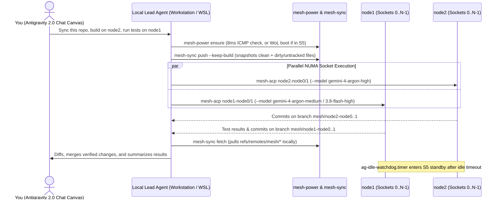

# Antigravity Agent Mesh

Turnkey orchestration, NUMA isolation, Git worktree synchronization, and Wake-on-LAN power automation for turning dual-socket Linux workstations (such as Dell Precision T7610s) into a bare-metal **Google Antigravity 2.0** subagent compute mesh.

---

## Key Capabilities

- **Hardware-Pinned NUMA Subagents (`mesh-acp`):** Dispatches parallel `stdio` JSON-RPC 2.0 ACP sessions (`agy acp`) across every physical CPU socket, isolated in `systemd` cgroups (`antigravity.slice`) and bound via `numactl --cpunodebind=<N> --membind=<N>`.
- **Live Dirty-Tree Git Sync (`mesh-sync`):** Snapshots local clean, modified, and untracked files using an isolated `GIT_INDEX_FILE` (`git write-tree` + `git commit-tree`) without touching your local `.git/index`, pushes to bare repos in `/opt/mesh/repos/<project>.git`, and maintains isolated per-socket worktrees (`mesh/<host>-node<N>`).
- **Cross-Worktree Shared SSD Caches:** Shares `/opt/mesh/cache/{ccache,cargo,npm,pip,buildroot-dl}` across all sockets on each host with `CCACHE_BASEDIR` + `CCACHE_NOHASHDIR=1` normalization for `100%` object cache hits across worktrees.
- **Zero-Watt S5 Power Automation (`mesh-power` & `ag-idle-watchdog`):** Automatically wakes sleeping nodes via Wake-on-LAN Magic Packets (`mesh-power ensure`) and powers them back into S5 standby after configurable idle minutes (`30m` default).
- **Offline Chassis Speaker TTS (`ag-notify`):** Optional *Interstellar*-inspired TARS/CASE voice and chime telemetry via `espeak-ng` + MBROLA + SoX (adapted from [primantah/tars](https://github.com/primantah/tars)) with `$(whoami)` operator binding.
- **Modular Opt-In Toolchains:** Installs a lean general-purpose compute environment by default; add `--with-eda` (KiCad 10 + Freerouting) or `--with-embedded` (ARM Cortex-M `gcc-arm-none-eabi`) only if needed.

---

## Architecture Overview



### Antigravity 2.0 Modes Comparison

| Feature | **Remote Agents** *(Cloud)* | **Remote Control** *(Host Daemon)* | **NUMA Compute Mesh** *(This Repo)* |
| :--- | :--- | :--- | :--- |
| **Execution** | Google-managed cloud container | Whole remote server via UI switcher | **Per-socket NUMA + cgroup** over direct LAN SSH |
| **Code Sync** | Requires GitHub push or upload | Reads `/opt/mesh/workspaces` | **`mesh-sync`:** Pushes live uncommitted + untracked edits in ~1s |
| **Parallelism** | 1 cloud agent per conversation | 1 interactive GUI per host | **Parallel fan-out (`mesh-acp all`)** across every socket |
| **Power** | Always on in cloud | Requires host powered on | **Auto-wakes via WoL** + auto-sleeps when idle |

---

## Quick Start

### 1. Prepare Your Compute Nodes
1. Install **Ubuntu Server LTS** (24.04 or 26.04) with OpenSSH enabled on two or more Linux/Dell NUMA hosts (optionally with a dedicated second SSD for `/opt/mesh`).
2. Copy your SSH key and grant passwordless `sudo` for your worker user (e.g., `ag-worker`):
   ```bash
   ssh-copy-id ag-worker@192.168.1.210
   ssh-copy-id ag-worker@192.168.1.211
   for ip in 192.168.1.210 192.168.1.211; do
     ssh -t "ag-worker@${ip}" "echo 'ag-worker ALL=(ALL) NOPASSWD:ALL' | sudo tee /etc/sudoers.d/90-ag-worker && sudo chmod 0440 /etc/sudoers.d/90-ag-worker"
   done
   ```

### 2. Bootstrap Control Plane & Provision Nodes
Run [`bootstrap-mesh.sh`](./bootstrap-mesh.sh) from your WSL or Linux workstation:

```bash
git clone https://github.com/CatoPaus/Antigravity-Agent-Mesh.git
cd Antigravity-Agent-Mesh
chmod +x bootstrap-mesh.sh provision-node.sh bin/* scripts/*

# Provision two nodes with custom aliases, IPs, and worker user:
./bootstrap-mesh.sh \
  --node node1=192.168.1.210,,tars \
  --node node2=192.168.1.211,,case \
  --user ag-worker \
  --provision-nodes --sync-auth --reboot-nodes --verify
```

**Optional Toolchain Flags:**
- `--with-eda` — Installs KiCad 10 PPA, headless JRE, and `freerouting.jar`.
- `--with-embedded` — Installs `gcc-arm-none-eabi` bare-metal ARM toolchain.
- `--no-tts` — Skips ALSA/SoX/MBROLA chassis speaker TTS installation.
- `--no-dell-bios` — Skips Dell Command | Configure (`cctk`) BIOS tuning (auto-detected by default).

### 3. Verify & Run Your First Multi-Socket Dispatch
```bash
# Check power, load, and idle countdown
mesh-power status

# List registered socket targets
mesh-acp --list-targets

# Sync current Git repository (including dirty/untracked files) and run across all sockets
mesh-acp all "Report hostname, pwd, and Cpus_allowed_list / Mems_allowed_list from /proc/self/status." \
  --sync --keep-build --model gemini-3.8-flash-low --skip-perms
```

---

## Repository Layout

```text
Antigravity-Agent-Mesh/
├── bootstrap-mesh.sh          # Master control-plane & cluster orchestrator
├── provision-node.sh          # Idempotent 9-stage remote node provisioner
├── bin/
│   ├── mesh-acp               # Event-driven Python asyncio ACP stdio dispatcher
│   ├── mesh-sync              # Bare-repo + multi-NUMA Git worktree synchronizer
│   ├── mesh-power             # Wake-on-LAN, S5 sleep, ensure, and TTS broadcaster
│   └── mesh-hygiene           # $HOME clutter, cache, and APT package-drift manager
├── config/
│   └── cluster.conf.example   # Reference cluster configuration template
├── rules/
│   └── mesh-cluster.md        # Global Antigravity 2.0 Lead Agent routing rule template
├── scripts/
│   ├── probe-node.sh          # CPU, NUMA, memory, disk, PCIe, and NIC discovery probe
│   └── test-sleep-wake.sh     # End-to-end S5 sleep & Wake-on-LAN benchmark test
└── docs/
    ├── SETUP-MANUAL.md        # Full step-by-step build, usage & TTS manual
    ├── DELL-T7610-BIOS.md     # Dell Precision T7610 BIOS, cctk & DIMM NUMA guide
    └── ARCHITECTURE.md        # Deep-dive on ACP, cgroups, Git snapshots & ccache
```

---

## Documentation

- **[Setup & Operations Manual](./docs/SETUP-MANUAL.md)** — End-to-end setup, Antigravity 2.0 Chat Canvas workflows, model selection strategy, and TARS/CASE TTS reference.
- **[Dell Precision T7610 BIOS & DIMM Guide](./docs/DELL-T7610-BIOS.md)** — `NodeInterleave` NUMA polarity, `cctk` headless BIOS tuning, and white-tab vs. black-tab memory channel balancing.
- **[Architecture Deep-Dive](./docs/ARCHITECTURE.md)** — Technical internals for `ag-acp-worker`, `GIT_INDEX_FILE` worktree sync, cross-worktree `ccache`, `ag-idle-watchdog`, and SoX DSP voice synthesis.

---

## License

[MIT](./LICENSE)
