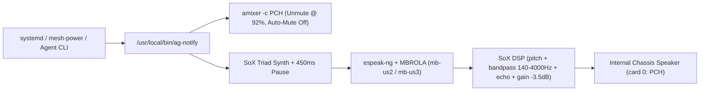

# Architecture Deep-Dive

This document explains the engineering decisions behind the **Antigravity Agent Mesh** runtime components installed on each compute node and on the local workstation control plane.

---

## 1. Per-Socket NUMA & Cgroup Isolation (`ag-numa-exec` & `antigravity.slice`)

On multi-socket Xeon systems, cross-socket QPI memory access adds latency and halves effective memory bandwidth. `provision-node.sh` isolates every worker inside two boundaries:

1. **`antigravity.slice` (`systemd` Cgroup v2):**
   - Dynamically sized at provision time from `nproc` and `/proc/meminfo` (reserving OS/SSH headroom so an overloaded build cannot freeze SSH or `sshd`).
   - Example on a 32-thread / 96 GiB server: `CPUQuota=2800%` (`28` of `32` threads), `MemoryHigh=76G`, `MemoryMax=84G`, `TasksMax=16384`.
2. **`/usr/local/bin/ag-numa-exec <node|interleave> <cmd...>`:**
   - Wraps workloads with `sudo systemd-run --quiet --scope --slice=antigravity.slice --uid="$(id -u)" --gid="$(id -g)"` and `numactl --cpunodebind="$NODE" --membind="$NODE"` (with `-p AllowedMemoryNodes="$NODE"` on multi-NUMA hosts).
   - Single-socket hosts gracefully fall back to `--interleave=all` without failing `AllowedMemoryNodes`.

---

## 2. ACP Stdio Worker Entrypoint (`ag-acp-worker` & `mesh-acp`)

### Preserving Environment Across `sudo`
Because `ag-numa-exec` invokes `sudo systemd-run`, `sudo`'s `env_reset` and `secure_path` strip caller environment variables (`PATH`, `HOME`, `NO_COLOR`, `TERM`, `CCACHE_*`). `/usr/local/bin/ag-acp-worker` executes `ag-numa-exec` with an explicit `env` wrapper:

```text
mesh-acp (WSL/Linux asyncio)
  └─▶ ssh -T <host> /usr/local/bin/ag-acp-worker <node> <subpath> [flags...]
        └─▶ /usr/local/bin/ag-numa-exec <node>
              └─▶ sudo systemd-run --scope --slice=antigravity.slice numactl ...
                    └─▶ env HOME=... CCACHE_DIR=... MAKEFLAGS=-jN agy acp "$@"
```

### Event-Driven JSON-RPC 2.0 State Machine
`bin/mesh-acp` drives `agy acp` over `stdio` using an asynchronous `recv_until_id` state machine (no brittle `sleep` barriers):
1. `initialize` (`protocolVersion: 1`)
2. `session/resume` (if `--resume` or `--continue` is passed, with automatic fallback to `session/new`)
3. `session/set_mode` (`accept-edits` by default)
4. `session/set_model` (if `--model` is passed)
5. `session/prompt` (handling `session/request_permission` callbacks and `session/update` chunks with a `16 MiB` line limit)

---

## 3. Dirty-Tree Git Synchronization (`mesh-sync` & `ag-mesh-worktree`)

Traditional remote runners require committing and pushing to GitHub before running tests. `bin/mesh-sync` syncs your **live working tree**—including uncommitted modifications and untracked files—without mutating your local `.git/index`:

1. Copies `.git/index` to a temporary `mktemp` index file (`GIT_INDEX_FILE`).
2. Runs `git add -A`, `git write-tree`, and `git commit-tree` against `HEAD` to create an ephemeral snapshot commit OID.
3. Force-pushes that single commit to `ssh://<host>/opt/mesh/repos/<project>.git` (`refs/heads/mesh-sync`).
4. Invokes `/usr/local/bin/ag-mesh-worktree` on each node, which strips any stray `refs/heads/HEAD` ref and checks out/resets `/opt/mesh/workspaces/node<N>/<project>` onto branch `mesh/<host>-node<N>`.
5. `mesh-sync fetch` pulls `refs/heads/mesh/<host>-node<N>` back locally as `refs/remotes/mesh/<host>-node<N>` for inspection, diffing, or cherry-picking.

---

## 4. Shared SSD Caches & Cross-Worktree `ccache`

Each socket works inside `/opt/mesh/workspaces/node<N>/<project>`. Without path normalization, identical source files in `node0/` and `node1/` would miss `ccache`. `ag-acp-worker` exports:
- `CCACHE_DIR=/opt/mesh/cache/ccache`
- `CCACHE_BASEDIR="$WORKSPACE_DIR"` (rewrites absolute worktree paths to relative paths)
- `CCACHE_NOHASHDIR=1` (ignores working-directory metadata in hashes)
- `CCACHE_SLOPPINESS="file_macro,time_macros"`

Alongside `ccache`, `BR2_DL_DIR`, `CARGO_HOME`, `npm_config_cache`, and `PIP_CACHE_DIR` all point to `/opt/mesh/cache/*`, while `~/.cache` and `~/.npm` are symlinked onto `/opt/mesh/cache` so root-partition wear stays near zero.

---

## 5. Wake-on-LAN & Idle S5 Standby (`mesh-power` & `ag-idle-watchdog`)

- **Auto-Wake (`mesh-power ensure`):** Performs a 1-packet ICMP ping check (`~8 ms` when awake). If any configured node is offline, it clears stale SSH `ControlMaster` sockets (`ssh -O exit`), broadcasts UDP Magic Packets (via `wakeonlan` and Windows PowerShell `UdpClient` on WSL), and polls SSH readiness.
- **Idle Watchdog (`ag-idle-watchdog.timer`):** Runs every 60 seconds and writes to `tmpfs` (`/run/ag-idle-minutes`, pre-created by `systemd-tmpfiles` to satisfy `fs.protected_regular=2`). It resets the counter to `0` if **any** of the following are active:
  1. Tasks inside `/sys/fs/cgroup/antigravity.slice/run-*.scope/cgroup.procs`
  2. Active worker/compiler processes (`ag-acp-worker`, `agy acp|chat|run|agent`, `ccache`, `gcc`, `clang`, `cargo`, `ninja`, `make`, `pytest`, Remote-SSH IDE servers)
  3. Interactive `agy` CLI processes or active children of `agy remote-control serve`
  4. Interactive SSH PTYs (`who`)
  5. Non-ControlMaster `sshd`/`sshd-session` child processes
  6. 1-minute load average above the scaled CPU threshold

Once the counter reaches `IDLE_LIMIT_MIN` (default `30`), the node logs to `journald`, plays `ag-notify offline`, and runs `systemctl poweroff` into S5 standby.

---

## 6. Offline Chassis TTS Signal Flow (`ag-notify`)


